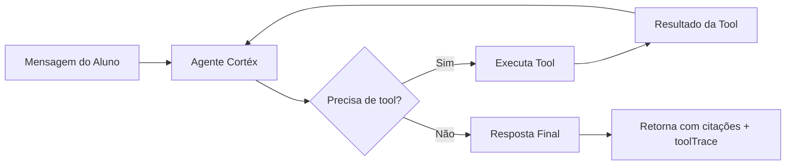
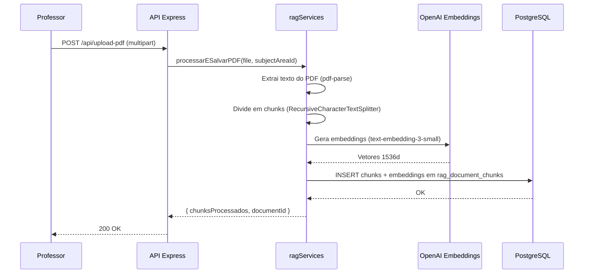
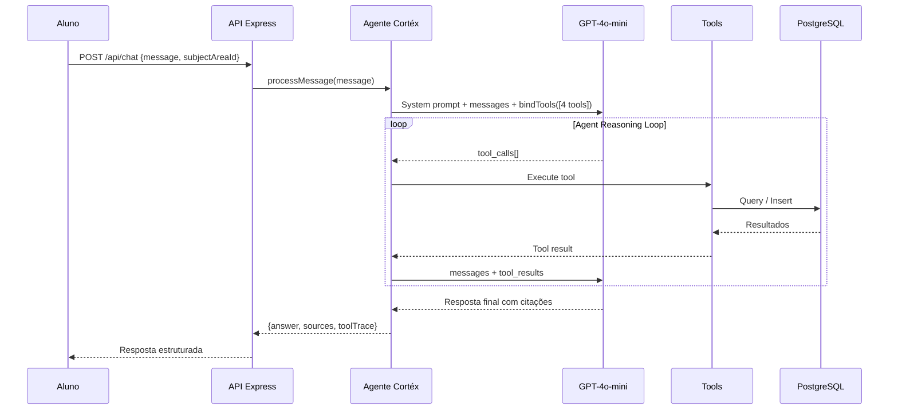

# Arquitetura SaaS — Cortéx Plataforma Educacional

> Documento técnico de arquitetura para o Hackathon AKCIT UFG 2026

## 1. Visão Geral da Arquitetura

O Cortéx SaaS segue uma arquitetura **cliente-servidor desacoplada** com um pipeline de IA baseado em **Agente Autônomo com Tool Calling**. A plataforma é composta por três camadas principais:

```
┌─────────────────────────────────────────────────────────┐
│                    CAMADA DE APRESENTAÇÃO                │
│           React 19 + TypeScript + Vite 8 + Tailwind 4   │
│  ┌──────────────────┐    ┌────────────────────────────┐  │
│  │ Portal Professor │    │ Terminal do Aluno (Estúdio) │  │
│  └──────────────────┘    └────────────────────────────┘  │
└──────────────────────────────┬──────────────────────────┘
                               │ HTTP REST
┌──────────────────────────────▼──────────────────────────┐
│                    CAMADA DE APLICAÇÃO                    │
│                   Node.js + Express :3001                │
│  ┌──────────────────────────────────────────────────┐    │
│  │          Agente Orquestrador Cortéx               │    │
│  │   LangChain.js + bindTools + Agent Loop           │    │
│  │   ┌────────────┬────────────┬──────────────────┐  │    │
│  │   │ Tool 1     │ Tool 2     │ Tool 3 │ Tool 4  │  │    │
│  │   │ Acervo     │ Estúdio    │ Lacuna │ Diagnóst│  │    │
│  │   └────────────┴────────────┴──────────────────┘  │    │
│  └──────────────────────────────────────────────────┘    │
└──────────────────────────────┬──────────────────────────┘
                               │
          ┌────────────────────┼────────────────────┐
          ▼                    ▼                    ▼
┌─────────────────┐  ┌─────────────────┐  ┌─────────────────┐
│  PostgreSQL 16  │  │  OpenAI API     │  │  OpenAI API     │
│  + pgvector     │  │  gpt-4o-mini    │  │  Embeddings     │
│  (dados+vetores)│  │  (raciocínio)   │  │  (text-emb-3)   │
└─────────────────┘  └─────────────────┘  └─────────────────┘
```

## 2. Componentes Detalhados

### 2.1 Frontend institucional (React + Vite)

O frontend atual mantém o site institucional e os fluxos de navegação do protótipo. A seção Painéis de IA e o Guia Cortéx abrem ambientes dedicados de aluno e professor que consomem os endpoints da API descritos neste documento. Os demais fluxos institucionais continuam separados; os painéis de IA são demonstrativos e não implementam autenticação ou controle de acesso. O servidor Vite de desenvolvimento usa a porta `5174`.

### 2.2 Backend (Node.js + Express)

| Rota | Método | Função |
|------|--------|--------|
| `/api/upload-pdf` | POST | Upload e processamento de PDF via multer → chunking → embedding → pgvector |
| `/api/chat` | POST | Recebe mensagem do aluno → envia ao Agente Cortéx → retorna resposta estruturada |
| `/api/lacunas` | GET | Lista lacunas de aprendizado registradas pelo agente |
| `/api/diagnostico` | POST | Gera diagnóstico pedagógico da turma para o professor |

### 2.3 Agente Orquestrador Cortéx (LangChain.js)

O núcleo do sistema é um **agente autônomo** que utiliza o padrão `bindTools` do LangChain.js para vincular 4 ferramentas ao modelo `gpt-4o-mini`. O agente opera em um **loop de raciocínio** onde:

1. Recebe a mensagem do usuário
2. Decide autonomamente quais tools chamar
3. Executa as tools e recebe os resultados
4. Alimenta os resultados de volta ao modelo
5. Repete até produzir uma resposta final em texto



### 2.4 As 4 Tools

#### `consultar_acervo_professor`
Busca vetorial no material do professor utilizando pgvector.

| Campo | Detalhe |
|-------|---------|
| Input | `query` (string), `subjectAreaId` (string) |
| Processo | Gera embedding → cosine similarity no pgvector → filtra por disciplina → top 4 chunks (similaridade ≥ 0.2) |
| Output | Trechos com citações rastreáveis `[1]`, `[2]` |

#### `gerar_estudio_aprendizado`
Cria materiais de estudo formatados aplicando o Método Cortéx.

| Campo | Detalhe |
|-------|---------|
| Input | `formato` (string), `topico` (string), `subjectAreaId` (string) |
| Processo | Consulta acervo → estrutura no formato pedido → aplica 5 passos Cortéx |
| Output | Material estruturado com pergunta de verificação |

**Formatos disponíveis:** Resumo Guiado, Roteiro de Áudio/Vídeo, Flashcards, Mapa Mental, Estudo Dirigido

#### `registrar_lacuna_aprendizado`
Registra dificuldades detectadas durante a interação.

| Campo | Detalhe |
|-------|---------|
| Input | `studentId`, `topic`, `tipo`, `descricao` |
| Tipos | `duvida_recorrente`, `tentativa_cola`, `erro_conceitual` |
| Output | Confirmação de registro |

#### `gerar_diagnostico_turma`
Gera relatório pedagógico para o professor.

| Campo | Detalhe |
|-------|---------|
| Input | `subjectAreaId` (string) |
| Processo | Agrega lacunas → cruza com material indexado → gera plano de intervenção |
| Output | Diagnóstico com tópicos críticos, frequência de dúvidas, plano de ação |

## 3. Modelo de Dados

### 3.1 Tabela `rag_document_chunks`
Armazena os chunks de documentos PDF com seus embeddings vetoriais.

```sql
CREATE TABLE rag_document_chunks (
    id            BIGSERIAL PRIMARY KEY,
    document_id   TEXT NOT NULL,
    subject_area_id TEXT NOT NULL,
    chunk_index   INTEGER NOT NULL,
    content       TEXT NOT NULL,
    metadata      JSONB DEFAULT '{}',
    embedding     VECTOR(1536),
    created_at    TIMESTAMPTZ NOT NULL DEFAULT NOW()
);

CREATE INDEX idx_chunks_embedding ON rag_document_chunks
    USING ivfflat (embedding vector_cosine_ops) WITH (lists = 100);
```

### 3.2 Tabela `lacunas_aprendizado`
Registra dificuldades de aprendizado detectadas pelo agente.

```sql
CREATE TABLE lacunas_aprendizado (
    id              BIGSERIAL PRIMARY KEY,
    student_id      TEXT NOT NULL,
    subject_area_id TEXT,
    topic           TEXT NOT NULL,
    tipo            TEXT NOT NULL,  -- 'duvida_recorrente' | 'tentativa_cola' | 'erro_conceitual'
    descricao       TEXT NOT NULL,
    created_at      TIMESTAMPTZ NOT NULL DEFAULT NOW()
);
```

## 4. Fluxo de Dados Completo

### 4.1 Upload de Material (Professor)



### 4.2 Chat do Aluno (Agente)



## 5. Método Cortéx — 5 Passos

O agente é instruído (via system prompt) a sempre aplicar os 5 passos do Método Cortéx ao gerar materiais de estudo:

| Passo | Nome | Descrição |
|-------|------|-----------|
| 1 | **Definir** | Estabelecer o objetivo de aprendizagem |
| 2 | **Selecionar** | Escolher fontes e materiais relevantes (via consultar_acervo) |
| 3 | **Criar** | Estruturar o conteúdo no formato solicitado |
| 4 | **Conferir** | Verificar compreensão com perguntas ativas |
| 5 | **Aplicar** | Exercício prático para consolidação |

## 6. Segurança e Boas Práticas

- **Variáveis de ambiente**: Todas as credenciais via `.env` (nunca commitadas)
- **Filtragem de conteúdo**: O agente só responde com base no material do professor (anti-alucinação)
- **Detecção de cola**: O agente identifica tentativas de obter respostas diretas e registra como `tentativa_cola`
- **CORS**: Configurado para aceitar requisições do frontend (`localhost:5173`)

## 7. Infraestrutura de Desenvolvimento

```
projeto_escola_cortex/
├── backend/
│   ├── src/
│   │   ├── server.js           # Express + rotas
│   │   ├── cortexAgent.js      # Agente com bindTools
│   │   └── ragServices.js      # Embeddings + pgvector
│   ├── package.json
│   └── .env.example
├── frontend/
│   ├── src/
│   │   ├── App.tsx             # Componente principal
│   │   ├── main.tsx            # Entry point
│   │   └── ...
│   ├── package.json
│   └── vite.config.ts
├── docs/
│   └── arquitetura-saas.md     # Este documento
├── .env.example
└── README.md
```

---

*Documento gerado para o Hackathon AKCIT UFG 2026 — Equipe Cortéx*
