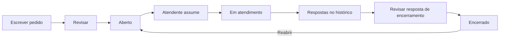

# Chamados persistidos e fila de suporte

Entrega local de 10/10/2026 (Bahia). O identificador da migração e a pasta de
evidências usam 11/10, data UTC da execução. Responsável: Codex, sob orientação
de Henry. Continuação dos marcos de acesso, agenda e comunicados.

## O que funciona

- Solicitante abre um chamado, revisa o texto e confirma. Recebe um protocolo UUID.
- Lista e histórico ficam no PostgreSQL e sobrevivem à recarga.
- Suporte consulta a fila por status, assume um chamado e responde.
- Encerramento exige uma resposta explicando a conclusão e confirmação na tela.
- Solicitante, atendente responsável ou administração podem reabrir um encerrado.
  Ele volta à fila sem atendente para nova atribuição.
- Histórico registra autor, ação, mensagem e horário. Sem edição ou exclusão via API.
- Lista paginada em 20 chamados; histórico em 30 registros, com acesso aos anteriores.

## Política de acesso

| Perfil | Leitura | Alterações |
|---|---|---|
| Aluno, responsável, professor | Apenas chamados abertos pela própria conta | Abrir, responder em chamado próprio não encerrado e reabrir o próprio |
| Suporte | Fila e detalhes de atendimento | Assumir chamado aberto/livre; responder, encerrar e reabrir os que assumiu |
| Administração | Fila e detalhes | Atuar em todos os chamados; encerramento exige estado em atendimento |

Chamados pertencem à **conta solicitante**, não ao estudante/turma. Mesmo Ana e
Lucas tendo vínculo acadêmico não compartilham chamados automaticamente. O suporte
recebe nome/identificador do solicitante e conteúdo do atendimento, sem e-mail,
senha, sessão, notas ou agenda. Acesso administrativo é explícito, não concedido
ao perfil docente. A administração pode responder sem assumir; suporte precisa assumir.

## Dados e API

`Ticket`: solicitante, atendente opcional, assunto, descrição, status, versão e
datas. `TicketEntry`: chamado, autor, ação, mensagem e data. Relações com Account,
chaves estrangeiras e índices em solicitante/status/histórico. Migração aditiva
`202610110001_chamados`, sem apagar dados dos marcos anteriores.

| Método | Rota sob /api | Corpo/filtro |
|---|---|---|
| GET | /tickets | page (1–10000), status opcional: open/in_progress/resolved |
| POST | /tickets | requestId UUID v4, title (3–120), description (3–5000) |
| GET | /tickets/:id | page opcional para histórico |
| POST | /tickets/:id/actions | requestId UUID v4, version inteiro, action, message |

Ações: `claim`, `reply`, `resolve`, `reopen`. Resposta/encerramento exigem mensagem
de 3–5000 caracteres. Assumir/reabrir exigem mensagem vazia. Autor, solicitante,
atendente e status nunca são aceitos como campos livres do cliente.

Transações serializáveis + versão protegem a concorrência. Apenas uma atribuição
vence; operações com versão obsoleta recebem 409. Identificadores de requisição
tornam repetição idêntica idempotente; reutilização por outro autor/conteúdo não
transfere autoria. Após resposta perdida, a tela conserva a tentativa e oferece
reenvio sem duplicação. Conflito confirmado pede atualização do histórico.

## Demonstração no localhost

1. Abrir `http://127.0.0.1:5173`, entrar como Ana e acessar **Atendimento**.
2. **Abrir chamado → Revisar → Confirmar abertura**.
3. Sair e entrar como Suporte: **Fila de suporte → Acompanhar → Assumir chamado**.
4. Escrever e revisar uma resposta; confirmar. Para concluir, selecionar
   **Encerrar com esta resposta** e confirmar o encerramento.
5. Entrar como Ana para ler e reabrir. Lucas não verá esse chamado em sua conta.

Contas e senha fictícia estão apenas em `.local-data/ACESSOS.md`, ignorada no Git.
O guia da landing agora orienta o usuário cadastrado a entrar no Atendimento.
Visitantes continuam sem canal público integrado; o portal demonstrativo é separado.

## Validação

- Build API e build frontend aprovados.
- 9 testes HTTP novos de atendimento + 11 testes anteriores aprovados.
- Três suítes Chrome headless: acesso/agenda, comunicados e atendimento aprovadas.
- Atendimento: revisão sem escrita, confirmação perdida após gravação, reenvio
  único, atribuição, respostas, encerramento, reabertura, persistência e logout
  em outra sessão. Rascunho preservado/descartável após encerramento concorrente.
- HTML hostil de teste permaneceu texto, sem criar imagem ou executar evento.
- Capturas desktop 1440px e mobile 390px em `evidencias/2026-10-11`; sem overflow
  horizontal no cenário móvel testado. Não é auditoria completa de acessibilidade.
- Verificações Purple Team e limites em `seguranca-atendimento-2026-10-10.md`.

## Limites e próximo marco

Sem anexos, notificações externas, prazos de SLA, prioridade, transferência manual
de atendente, pesquisa textual ou atendimento por IA. Rascunhos são locais; trocar
de seção/sair exige concluir ou descartar. Recarregar recebe aviso do navegador.
A paginação não é uma fotografia imutável da fila durante alterações concorrentes.
O ambiente é de desenvolvimento, com dados fictícios, sem deploy público.

Próximo marco: recuperação real de acesso e captação persistida. Antes de produção,
definir canal de envio, política de dados/retenção, operação de contas, HTTPS,
backups/restauração e homologação da equipe. Henry/Eduardo podem conduzir a integração;
Joelly/Eduarda, testes/documentação; Danilo/Luna, revisão mobile e apresentação.
Divisão sugerida, a confirmar pelo grupo no planejamento de 90 dias.
