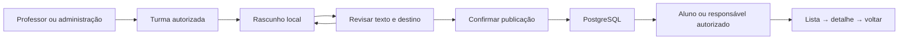
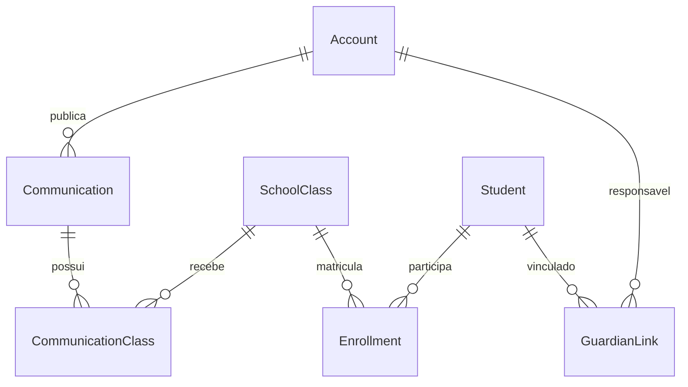

# Marco: comunicados por turma

Entrega e verificações locais em 10/10/2026. Implementação: Codex, sob orientação
de Henry. O marco anterior integrou acesso e agenda; este adiciona comunicados
persistidos no PostgreSQL, com a identidade visual existente.

## Demonstrar o resultado

1. Abrir `http://127.0.0.1:5173` com banco, API e frontend ativos.
2. Em **Já tenho cadastro**, entrar como Marina. Credenciais fictícias apenas em
   `.local-data/ACESSOS.md`, fora do Git.
3. Abrir **Comunicados → Novo comunicado**, escrever título e mensagem.
4. Revisar conteúdo e turma; voltar para editar ou confirmar publicação.
5. Sair e entrar como Ana. Selecionar Lucas para ler; Bia não recebe o aviso.
   Recarregar preserva a sessão e a publicação.

Testes removem os próprios comunicados sintéticos; a lista pode estar vazia até
uma publicação manual. Não há envio externo por e-mail, WhatsApp ou notificações.

## Fluxo e modelo

Migração aditiva `202610100002_comunicados`: conteúdo, autor, horário e associação
com turma, com chaves estrangeiras e índices. A estrutura permite N:N, mas a API
publica em **uma turma por operação**. `AccessService` centraliza vínculos de
agenda e comunicados. Autoria vem da sessão; matrícula deve estar ativa e vínculo
do responsável verificado. Suporte não recebe acesso acadêmico. O detalhe refaz
a autorização mesmo quando o identificador é conhecido.

O UUID de publicação permite repetir a mesma tentativa sem duplicar. Conteúdo
e destino são gravados atomicamente. Mesmo ID com conteúdo, autor ou turma
diferentes retorna 409. Quando a resposta se perde, a tela conserva a tentativa
e bloqueia edição até confirmar o resultado.

## Interface

Mantidos logo, Sora/Source Sans 3, azul escuro, verde e fundo claro. Navegação
Agenda/Comunicados e contexto acadêmico explícitos. Voltar do detalhe mantém o
estudante selecionado. Há estados de carga, vazio, erro e sucesso; mudanças de
etapa focam o título e texto preserva quebras de linha.

Rascunhos bloqueiam troca de turma/agenda; recarga recebe aviso do navegador.
Não há autosalvamento: sair da conta ou confirmar saída da página descarta o texto.
Antes da publicação, a revisão identifica os destinatários.

## Validação observada nesta sessão

| Verificação | Resultado |
|---|---|
| Migração PostgreSQL local | Aplicada sem apagar agenda |
| Builds NestJS e TypeScript/Vite | Aprovados |
| Integração HTTP com PostgreSQL | 11 testes aprovados |
| Regressão de acesso/agenda em Chrome headless | Aprovada |
| Comunicados em Chrome headless | Revisão sem escrita, edição, publicação e leitura aprovadas |
| Resposta perdida após gravação | Reenvio confirmado com apenas um registro |
| Desktop 1440px/mobile 390px | Capturas revisadas; sem overflow horizontal em 390px |
| Auditor local Purple Team | 41 arquivos; um alerta heurístico no e-mail do seed |

Alerta revisado: e-mail fictício interpolado em objeto Prisma, sem concatenação
de SQL. O auditor omite segredos e não cobre histórico Git, CVEs, fluxo completo
de dados ou rede. Não é auditoria completa de segurança. Testes visuais também
não cobrem todos os dispositivos ou toda a acessibilidade.

Capturas em `evidencias/2026-10-10`: `comunicado-revisao-desktop.png`,
`comunicado-leitura-desktop.png`, `comunicado-leitura-mobile.png`.
Comandos reproduzíveis em `backend/README.md`.

## Próximos marcos do plano de 90 dias

Datas oficiais de início/fim precisam ser confirmadas pela equipe. Os prazos
abaixo são propostas por ciclo, não compromissos já aceitos. Atividades podem
evoluir em paralelo; não somar os prazos máximos originais como etapas sequenciais.

| Marco | Responsáveis sugeridos | Prazo proposto | Indicador |
|---|---|---|---|
| Chamados e fila de suporte | Henry e Eduardo | Próximo ciclo, 5 dias úteis | Abrir, consultar e responder com autorização e histórico persistido |
| Testes e documentação dos fluxos | Joelly e Eduarda | Paralelo, 5 dias úteis | Roteiro executado, evidências e defeitos registrados |
| Recuperação de acesso e captação | Henry e Eduardo | Ciclo seguinte, 5 dias úteis | Token temporário de uso único, canal de envio definido, interesse persistido |
| Mobile, conteúdo e apresentação | Danilo e Luna | Em paralelo | Fluxos revisados e relatório acadêmico atualizado |
| Assistente guiado e IA | Henry e revisão do grupo | Após dados e suporte estáveis | Encaminhamento correto e limites verificados |
| Homologação e deploy | Equipe, liderança a confirmar | Reserva final do plano | Testes, HTTPS, backup/restauração e demonstração |

Fora deste marco: anexos, edição/exclusão, rascunho persistente, recibos de leitura
e notificações. Antes de produção: paginação, retenção/moderação, operação de
contas, recuperação, HTTPS e validação de segurança/acessibilidade. Ambiente
atual exclusivamente local e fictício.
