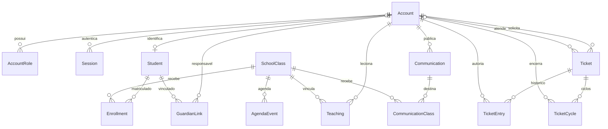
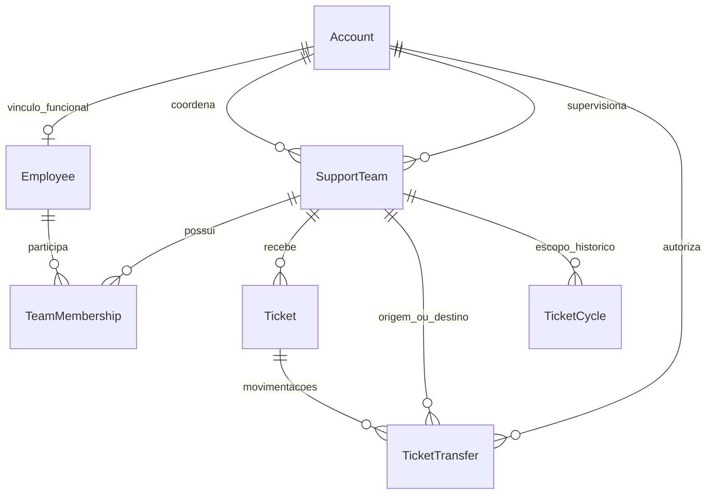

> Atualização: equipes e secretaria implementadas em 11/10. O desenho abaixo é a proposta histórica; Employee foi representado por Account + TeamMember e transferências por TicketEntry. Estado, matriz aplicada e limitações em [relatório da entrega](equipes-secretaria-2026-10-11.md).

# Entidades, equipes e permissões

11/10/2026. **Modelo atual confirmado; evolução ainda não implementada.**

## Modelo físico atual

AccountRole permite múltiplos papéis. GuardianLink exige vínculo verificado; Enrollment, matrícula ativa; Teaching limita professor às turmas vinculadas. Ticket.version detecta concorrência. TicketCycle guarda metas, resposta, encerramento, autor da resolução e CSAT; reabrir cria outro ciclo.

## Evolução proposta

Funcionário é vínculo da conta, não outra credencial. Não duplicar senha/e-mail em tabelas paralelas.

| Entidade proposta | Dados/regras |
|---|---|
| Employee | accountId único, estado ativo/inativo; desativação impede novas atribuições sem apagar histórico |
| SupportTeam | Nome, estado, supervisor e coordenador ativos com papéis correspondentes |
| TeamMembership | Funcionário/equipe únicos, estado e datas; capacidade global por pessoa, mesmo em várias equipes |
| Ticket.teamId | Equipe atual; distribuição restrita aos membros elegíveis |
| TicketTransfer | Origem/destino, atendentes anterior/novo, ADMIN autor, motivo, data, chave de idempotência; imutável |
| TicketCycle.teamId | Escopo histórico congelado, independente de mudanças posteriores de funcionários |

Proposta para transferência: preservar início/metas do ciclo e atribuir resultado à equipe que encerrou, explicitando a regra no dashboard. Históricos sem equipe permanecem legados, sem atribuição fictícia. Confirmar a regra antes da migração.

## Política solicitada

**Somente ADMIN cria/altera/desativa equipes, funcionários, vínculos, gestores, transferências e metas.** API deve negar mutações diretas de outros perfis; esconder botões não basta. Identidade/alcance vêm da sessão e banco, nunca do navegador.

| Papel | Consulta pretendida | Gestão administrativa |
|---|---|---|
| ADMIN | Instituição | Permitida com auditoria |
| Coordenador | Equipes sob sua coordenação | Negada |
| Supervisor | Equipes sob sua supervisão | Negada |
| Atendente | Chamados próprios/atribuídos, fila elegível e métricas próprias | Negada |
| Professor | Turmas vinculadas e próprios chamados | Negada |
| Responsável | Alunos com vínculo verificado e próprios chamados | Negada |
| Aluno | Próprios dados/chamados | Negada |

**Confirmação recebida em 11/10:** gestão administrativa exclusiva ADMIN, mantendo operações por papel. A pergunta histórica era: exclusividade administrativa também retira ações operacionais existentes? Hoje atendente responde/encerra, solicitante abre/responde/avalia, professor publica para sua turma. Não alterar silenciosamente esses fluxos. Esta tabela é requisito futuro, não garantia atual: supervisor/coordenador ainda têm alcance institucional no código.

## Aceite da implementação

1. Migração aditiva com estratégia para legados; preservar ciclos, notas e autoria.
2. Somente ADMIN altera gestão; testar 403 nas chamadas diretas dos demais papéis.
3. Supervisor A não lista, abre nem agrega dados de B. Coordenador vê equipes vinculadas. Sem vínculo, nenhum acesso institucional implícito.
4. Distribuição respeita equipe, conta ativa, disponibilidade e capacidade global; testar concorrência entre duas equipes.
5. Transferência exige motivo, versão e destino elegível; repetição idempotente, destino inválido não altera dados.
6. Cobrir papéis combinados, conta desativada, troca maliciosa de IDs e relatório após transferência.
7. Validar telas de gestão/consulta, confirmação e erros em desktop/mobile.

## Depois: SLA aberto e metas

Lista de abertos com prazo, tempo útil consumido, situação e filtros autorizados. ADMIN edita políticas versionadas; ciclos guardam snapshot sem alterar métricas antigas. Separar backlog atual de relatório de encerrados. Validar fronteiras, finais de semana, reabertura e mudança de política. Horários/feriados permanecem demonstrativos até definição.
