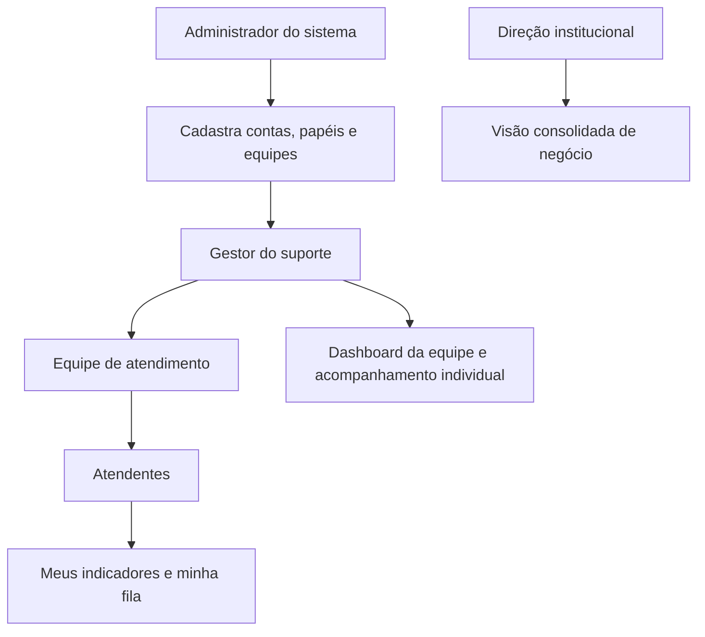

# Gestão do atendimento — métricas, hierarquia e dashboard

Atualização em 11/10: implementação parcial e mudança do recorte para **ciclos
encerrados no período**, conforme novo pedido de Henry. Estado real e limites
em [marco da operação](operacao-metricas-2026-10-11.md). O restante abaixo é proposta,
não deve ser interpretado como funcionalidade já entregue.

Especificação do próximo marco, registrada em 10/10/2026. Henry autorizou propor
configuração demonstrativa porque horários e metas reais ainda não foram definidos.
**Este documento não implementa indicadores, CSAT, papéis ou dashboards.**

## Diagnóstico do código atual

Ticket/TicketEntry registram abertura, atribuição, respostas, encerramento e
reabertura, com autoria e datas. É uma base de eventos; ainda não existe apuração
de métricas, política SLA, calendário útil, avaliação CSAT ou papel de gestor.
Suporte/admin consultam toda a fila da instituição. Não há vínculo funcionário →
gestor/equipe nem gestão operacional de funcionários. Estes recursos serão novos.

## Hierarquia proposta

Hierarquia organizacional não significa herança automática de todas as permissões.
Administração técnica e gestão de pessoas são atribuições distintas. No MVP uma
mesma pessoa pode acumular papéis explicitamente; não presumir quem será o gestor
entre os seis membros do trabalho acadêmico.

| Papel | Acesso proposto | Limite |
|---|---|---|
| Administrador do sistema | Provisionar/desativar contas, papéis, equipes e calendário/SLA; visão institucional | Não usar conta compartilhada; alterações sensíveis auditadas |
| Gestor do suporte | Sua equipe: fila, metas, indicadores, atribuição/redistribuição e acompanhamento | Não criar administradores nem acessar outras equipes por parâmetro de URL |
| Atendente | Próprios indicadores e operação dos chamados autorizados na equipe | Não ver avaliações detalhadas de colegas nem alterar metas/notas |
| Direção (etapa posterior) | Indicadores consolidados, tendências e capacidade | Conteúdo pessoal dos chamados não é necessário para visão executiva |
| Solicitante | Seus chamados, prazos e avaliação do próprio atendimento | Sem acesso aos dashboards de funcionários |

O gestor acompanha desempenho e organiza a fila; o administrador concede acesso
e mantém a estrutura. Não ampliar isto para folha de pagamento, ponto ou sistema
de RH no escopo acadêmico. Desativar um atendente deve permitir redistribuir seus
chamados preservando autoria/histórico, sem apagar a conta histórica.

## Configuração demonstrativa

- Fuso: America/Bahia; segunda a sexta, 09:00–17:00.
- Primeira resposta: até 4 horas úteis; resolução: até 16 horas úteis.
- Metas de cumprimento ilustrativas: 90% e 85%, respectivamente.
- Feriados ainda não cadastrados; indicador deve dizer isso. Sem pausa automática
  do relógio por espera do solicitante nesta versão de demonstração.
- CSAT: escala 1–5; 4/5 representam satisfação; alvo ilustrativo de 85%.
- Não fixar meta de TMA ou ranking de velocidade antes de observar volume,
  assunto e complexidade. Todos estes valores são propostas locais, não benchmarks
  da Blip, iFood ou compromissos de atendimento do Cortéx.

Exemplo de calendário sem feriado: aberto sexta às 16h, prazo de primeira resposta
segunda às 12h. Uma mensagem automática e o botão Assumir não satisfazem esse SLA.
Cada chamado/ciclo conserva a versão da política aplicada; mudar metas não deve
reescrever resultados históricos.

## Dicionário dos indicadores

Unidade principal: **ciclo de atendimento**. Abertura inicia o primeiro; reabertura
inicia outro, sem apagar o anterior. Datas em UTC no banco, exibidas no fuso da
operação. Cálculos úteis usam calendário versionado. Duração nula/incompleta é
"Sem dados", nunca zero. Registrar data da última atualização em toda consulta.

| Indicador | Definição proposta | Atribuição/observação |
|---|---|---|
| Tempo de primeira resposta | Horas úteis do início do ciclo à primeira mensagem pública humana da equipe | Responsabilidade operacional da equipe; mostrar espera na fila separadamente |
| SLA de primeira resposta | Percentual de ciclos respondidos dentro da meta entre os avaliáveis | Assumir, bot e resposta do solicitante não contam |
| Tempo de resolução | Horas úteis do início do ciclo ao encerramento | Inclui espera na fila; diferente do TMA |
| SLA de resolução | Percentual de ciclos encerrados dentro da meta entre os avaliáveis | Ciclos abertos já vencidos entram como descumprimento |
| TMA decorrido | Média de horas úteis da primeira resposta humana ao encerramento dos ciclos concluídos | Inclui intervalos de espera; não equivale a minutos de trabalho ativo |
| CSAT | Respostas 4 ou 5 ÷ avaliações válidas × 100 | Mostrar também distribuição 1–5, média opcional e quantidade de respostas |
| Adesão ao CSAT | Ciclos avaliados ÷ ciclos elegíveis encerrados × 100 | Separar satisfação de falta de resposta |
| Backlog | Chamados atualmente abertos/em atendimento | Estoque atual, não restringir silenciosamente à data de criação do filtro |
| Em risco/vencidos | Ciclos ativos entre 80–100% / acima de 100% da meta consumida | Exibir tipo de SLA, prazo e atraso; sem depender somente de cor |
| Volume | Chamados criados, ciclos reabertos e ciclos encerrados por dia | Mostrar unidades distintas, sem chamar toda reabertura de novo cliente |
| Reabertura em 7 dias | Ciclos encerrados reabertos em até 7 dias ÷ encerrados com 7 dias completos de observação | Casos recentes ficam em acompanhamento, sem inflar resultado |
| Espera para atribuição | Horas úteis até primeiro atendente assumir | Medida da fila/equipe, não penalidade automática ao último atendente |

**Denominadores dos SLAs:** coorte de ciclos iniciados no período selecionado.
Avaliável = já respondeu/encerrou para o SLA correspondente OU está ativo e já
venceu a meta. Pendentes ainda dentro do prazo ficam fora do denominador, exibidos
separadamente. Numerador = resposta/encerramento em até a meta. Assim, chamados
vencidos ainda abertos não desaparecem da taxa. Exibir numerador, denominador e
pendentes na descrição do cartão. Comparações entre períodos devem explicitar
que a coorte recente ainda pode estar imatura.

**Tempos médios:** usar ciclos encerrados no período, mostrando tamanho de amostra,
mediana e P90 quando houver amostra suficiente; rótulo distingue esta população da
coorte usada para SLA. Não somar médias de atendentes: recalcular pelos eventos.

**Desempenho individual:** primeira resposta atribuída a quem a enviou; resolução
a quem encerrou. Espera antes da atribuição permanece indicador da equipe. Em casos
com transferência, TMA total e CSAT pertencem ao ciclo/equipe, sinalizando múltiplos
participantes; não atribuir toda a duração/nota ao último atendente. Futuro tempo
ativo exige sessões de trabalho/pausas explícitas, atualmente inexistentes.

## CSAT no fluxo

Após encerramento: "Como você avalia este atendimento?", botões de 1 a 5 com
rótulos textuais, comentário opcional e confirmação. Não exigir avaliação para
reabrir. Somente a conta solicitante pode enviar uma avaliação por ciclo encerrado.
Reenvio idêntico é idempotente; alterações indevidas são rejeitadas. Atendentes não
podem avaliar em nome do cliente ou apagar notas. Excluir autoatendimento de
funcionário em chamado próprio da avaliação de desempenho. Comentário exige escopo
de acesso e tratamento de dados; nunca entrar em logs públicos.

Exemplo de apresentação: "CSAT 80% · 8 de 10 avaliações satisfeitas · adesão 25%
(10/40)". É exemplo aritmético, não resultado do banco. Amostra pequena recebe
aviso e não vira ranking confiável. Reabertura preserva nota anterior e permite
avaliar o novo ciclo após outro encerramento.

## UX/UI proposta

Gestor: **Gestão → Visão geral / Equipe / Fila em risco / Qualidade / Metas**.
Atendente: **Atendimento → Minha fila / Meus indicadores**. Direção: consolidado.
Painéis devem explicar o próximo passo operacional, não apenas exibir números.

1. Cabeçalho com período, equipe e atendente conforme permissão; timezone,
   atualização e aviso "Metas de demonstração" sempre visíveis.
2. Primeira faixa com quatro cartões: SLA 1ª resposta, SLA resolução, CSAT e
   backlog vencido. Cada um inclui meta, amostra/população e definição acessível.
3. Gráfico de linhas para criados/encerrados por dia; barras para distribuição
   da idade dos chamados. Legendas diretas e tabela equivalente acessível.
4. Fila de ação priorizada pelo vencimento: protocolo, responsável, status,
   prazo e botão Abrir chamado. Clicar nunca contorna a autorização da API.
5. Tabela de equipe com volume, espera após atribuição, SLAs, TMA decorrido,
   CSAT e amostras. Filtros por assunto/complexidade antes de comparar pessoas.
6. Qualidade: distribuição das notas e reaberturas; comentários apenas no escopo
   permitido. Evitar ranking público, medidores decorativos e gráficos 3D.

Manter Sora/Source Sans 3, azul escuro/verde e superfícies claras do Cortéx. Estados
vazio, carregamento e erro explícitos. Mobile: cartões em duas colunas ou uma em
larguras pequenas, filtros recolhíveis com resumo ativo, lista de atendentes em
cards e gráficos com descrição textual. Tabelas largas podem ter rolagem própria,
nunca provocar overflow da página. Cor sempre acompanhada de texto/ícone.

Esta é arquitetura de interface; ainda não existe tela de métricas implementada.
Começar com componentes React existentes e gráficos simples acessíveis; decidir
biblioteca após validar os tipos de gráfico, sem adicionar dependência só pela aparência.

## Dados, autorização e integridade

Novos conceitos: SupportTeam, Membership (função/validade), política SLA versionada,
calendário, TicketCycle, atribuições históricas, ator/contexto de cada evento e
CsatResponse com unicidade por ciclo. TicketCycle guarda início, primeira resposta,
encerramento, política e equipe; CsatResponse guarda ciclo, solicitante, nota e data.
Servidor define os timestamps, atores e vínculos. Não aceitar notas agregadas,
tempos medidos, assigneeId arbitrário ou teamId como autorização enviada pelo browser.

API de métricas aplica escopo do usuário também em totais, séries, filtros, opções
de atendentes e exportações. Atendente não amplia acesso trocando agentId/teamId.
Gestor não pode promover a própria conta. Toda mudança de papel/equipe/meta e
transferência gera auditoria. Permissões revogadas devem valer na próxima requisição.
Admin técnico não ganha acesso invisível: papel e uso administrativo ficam explícitos.

Eventos antigos não guardam todas as políticas/papéis históricos. Não inferir dados
ausentes usando o papel atual da conta e apresentá-los como medição exata. Marcar
histórico incompleto; iniciar apuração oficial após a migração/instrumentação.

## Ordem de implementação e aceite

1. **Governança:** gestor/equipe/membros e políticas versionadas. Aceite: escopo
   conferido na API e teste de tentativa de escalar privilégios.
2. **Instrumentação:** ciclos, primeira resposta, relógio útil e atribuições
   históricas. Aceite: horários fora do expediente, fim de semana, feriado,
   reabertura, simultaneidade e troca de política com resultado determinístico.
3. **CSAT:** formulário e endpoint por solicitante/ciclo. Aceite: autoria, nota
   válida, unicidade, reenvio, chamado aberto e tentativa de avaliar chamado alheio.
4. **Apuração/dashboard:** visão pessoal e gestão com mesma fonte de cálculo.
   Aceite: fórmulas/denominadores, casos sem dados, acesso entre equipes, paginação,
   mobile, teclado e dados sintéticos explicitamente separados dos reais.
5. **Gestão operacional:** redistribuição, desativação segura e revisão de metas.
   Métricas educacionais/comerciais somente após integrar seus dados.

Recuperação de acesso e captação continuam pendentes; gestão e métricas passam a
ser o próximo marco proposto pelo pedido atual. Não prometer todas as funcionalidades
de uma plataforma comercial no prazo acadêmico. Henry e o grupo devem definir
quem acumulará gestão no MVP e quando homologar as metas reais.

## Indicadores institucionais posteriores

Conversão interesse → matrícula depende de captação e matrícula reais. Presença,
participação e progresso pedagógico dependem de dados educacionais e critérios
validados. Não usar duração do chat ou volume de tickets como evidência de evolução
do aluno; não inventar receita, retenção ou resultado educacional no dashboard atual.

## Referências consultadas

- [Blip — Relatório de atendimento](https://help.blip.ai/hc/pt-br/articles/14913405614743-Relat%C3%B3rio-de-atendimento): referência para separação entre fila, tempos, relatórios por atendente e filtros. Suas populações e fórmulas não são automaticamente as do Cortéx.
- [Blip — SLA no relatório de atendimento e anotações](https://help.blip.ai/hc/pt-br/articles/19486406863383-SLA-Relat%C3%B3rio-de-atendimento-anota%C3%A7%C3%B5es): mostra outra definição operacional de primeira resposta, reforçando a necessidade de explicitar o evento inicial/final escolhido.
- [Blip — Modelos de relatórios](https://www.blip.ai/blog/comunidade/modelos-de-relatorios-do-blip/): inspiração para monitoramento e gestão histórica.

Não foi verificada a configuração interna do iFood; a referência é a documentação
pública da Blip. Metas, hierarquia e desenho acima são propostas específicas do Cortéx.
